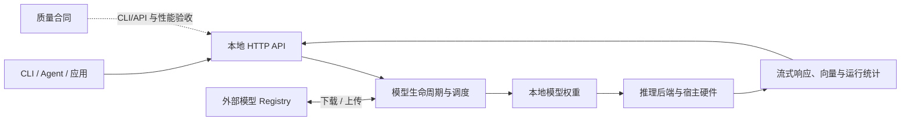

# Ollama · Recipkg

**本地模型运行器配方：覆盖 CLI、服务 API、模型管理，以及它们与 Agent 的连接。**

[标准库](https://github.com/recipkg/standard-library) · [配方](RECIPE.md) · [来源](SOURCES.md) · [重建要求](BUILD_PROMPT.md) · [验收](ACCEPTANCE.md) · [覆盖状态](COVERAGE.md)


固定来源为 Ollama `v0.40.13`。本仓库只包含 Markdown 配方，不含 Ollama 源码、发行包或模型权重。当前本机 CLI 是 `0.20.2`，所以运行证据有限；API、模型生命周期和硬件覆盖仍待验证。



模型权重、registry、硬件驱动和各模型许可均是外部边界。测试必须明确模型与设备；本地推理吞吐不能脱离硬件和模型单独比较。

## 使用

```sh
work="$(mktemp -d)"
recipkg pack . -o "$work/ollama.recipe.tar.gz"
recipkg check "$work/ollama.recipe.tar.gz"
recipkg build "$work/ollama.recipe.tar.gz" --lang zh-CN --output "$work/build.md"
```

Recipkg 只收集并渲染提示词，不会安装 Ollama、启动服务或下载模型。
